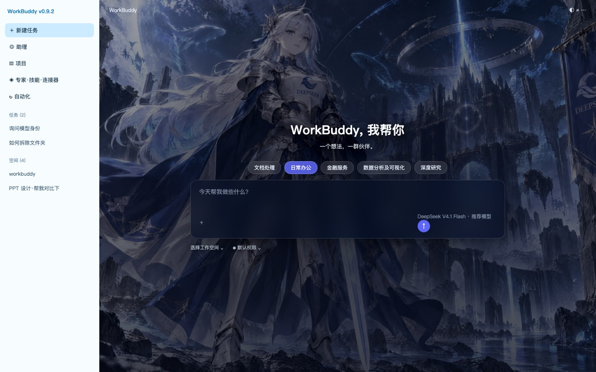

# workbuddy-skin-change

给 WorkBuddy 桌面客户端换首页背景图的 Skill。发一张图，自动装进主题缓存，等比铺满、不拉伸。

> 非官方方案。WorkBuddy 没有提供导入自定义主题的入口，本项目通过替换本地主题缓存里的 `skin.v2.css` 实现。默认作用对象是「经典 QQ」主题。



## 原理

WorkBuddy 的主题是服务端下发的 zip 包，解压到：

```
~/.workbuddy/appearance-resources/<resourceKey>-<updatedAt>/
```

客户端读取该目录下的 `skin.v2.css`，注入 `<style data-skin-sheet="skin">`。读取逻辑只做「读文件 → 返回文本」，**不校验 hash、不校验签名**，缓存命中就直接用。

所以本地这个文件就是事实上的皮肤源。本项目在它末尾追加一段带作用域的覆盖层：首页主区背景、文字层级、输入框玻璃质感、快捷标签。左侧栏和其余页面不动。

## 安装

```bash
git clone https://github.com/mastarai2024-del/workbuddy-skin-change.git \
  ~/.workbuddy/skills/workbuddy-skin-change
```

或手动把本仓库放进 `~/.workbuddy/skills/workbuddy-skin-change/`，然后重启 WorkBuddy 让技能列表刷新。

**环境要求**：macOS。脚本用 `sips` 读图片尺寸，用 Chrome headless 出预览图。

## 用法

```bash
# 换图（默认经典 QQ 主题）
python3 ~/.workbuddy/skills/workbuddy-skin-change/scripts/apply_skin.py \
  --image /path/to/pic.jpg

# 换到别的主题
python3 ~/.workbuddy/skills/workbuddy-skin-change/scripts/apply_skin.py \
  --image pic.jpg --theme mint

# 调整构图（主体偏下 / 偏上）
python3 ~/.workbuddy/skills/workbuddy-skin-change/scripts/apply_skin.py \
  --image pic.jpg --position "center 20%"

# 只预演，不落盘
python3 ... --image pic.jpg --dry-run
```

脚本会：定位主题目录 → 备份 `skin.css.bak-*` → 图片复制进 `assets/custom/` → 渲染覆盖层 → 替换 CSS 段 → 校验花括号平衡 → 输出 JSON。

改完在「设置 → 外观」切到目标主题（或切走再切回），点「新建任务」回首页查看。首屏若仍是旧样式，重启应用一次。

## 图片参数

| 项目 | 推荐值 | 可接受范围 | 原因 |
|---|---|---|---|
| 分辨率 | 2560 × 1440 | 最短边 ≥ 900px | 1440 宽窗口下主区约 1200px，2× 屏需 2400px |
| 画面比例 | 16:9（1.778） | 1.5 : 1 ～ 2.0 : 1 | 主区比例约 1.33，cover 后左右各裁约 11% |
| 格式 | JPG | PNG / WebP / AVIF | 需要透明通道时才用 PNG |
| 文件体积 | < 4 MB | 上限 15 MB | 超过 15 MB 脚本直接拒绝 |
| 构图 | 主体居中，或偏左 1/3 | — | 左右边缘各 11% 会被裁，别放关键内容 |
| 亮度 | 中低调（深蓝 / 墨绿 / 暗红） | — | 界面文字统一转白，底图过亮会糊 |

**不改变画面比例**：只用 `background-size: cover`，等比缩放后居中裁切，永远不拉伸。宽高比不合时裁切量变大，画面不变形。

## 支持的主题

| 别名 | 主题资源目录 |
|---|---|
| `qq`（默认） | `workbuddy-skin-qqblue` |
| `purple` / `clearsky` | `workbuddy-skin-purple` |
| `mint` | `workbuddy-skin-mint` |
| `green` / `forest` | `workbuddy-skin-green` |
| `jinqiu` | `WorkBuddy皮肤_激战金秋-龙狮城_v10` |
| `sapphire` | `theme-tkhlwz` |
| `blue-video` | `workbuddy-skin-blue-video-fallback` |

不在表里的主题，可以直接传资源文件夹名：`--theme workbuddy-skin-xxx`。

## 撤销

```bash
python3 ~/.workbuddy/skills/workbuddy-skin-change/scripts/apply_skin.py --revert --theme qq
```

恢复到最早那份 `skin.css.bak-*`（官方原版）。备份只保留一份，重复执行不会覆盖它。

也可以手工删掉 `skin.v2.css` 里 `CUSTOM SKIN OVERLAY` 到 `CUSTOM SKIN OVERLAY END` 之间的整段。

## 已知限制

| 限制 | 表现 | 处理 |
|---|---|---|
| 主题在服务端更新 | 生成新 `updatedAt` 目录，覆盖层失效 | 重跑脚本 |
| LRU 清理 | 旧主题目录被回收，改动一起没了 | 重跑脚本 |
| 应用升级 | 缓存路径或加载机制可能变 | 重跑脚本；仍无效则不要改应用包 |
| 只覆盖首页 | 对话页、设置页仍是原主题浅色 | 属预期；全站深色需另做方案 |
| 侧栏保持浅色 | 与深色主区形成明暗分区 | 属预期，QQ 主题的识别特征 |
| 切到别的主题 | 覆盖层不生效 | 脚本只改指定主题 |

## 目录结构

```
SKILL.md                  技能说明（触发词、参数、限制、回滚）
scripts/apply_skin.py     主脚本
assets/overlay.css.tpl    CSS 覆盖层模板
assets/preview.html       1440×900 预览模板（模拟首页结构，用于检查构图）
```

预览图生成：

```bash
python3 - <<'PY'
from pathlib import Path
tpl = Path.home()/'.workbuddy/skills/workbuddy-skin-change/assets/preview.html'
html = tpl.read_text(encoding='utf-8').replace('__BG__', '/绝对路径/图片.jpg')
Path('/tmp/wbskin-preview.html').write_text(html, encoding='utf-8')
PY
"/Applications/Google Chrome.app/Contents/MacOS/Google Chrome" --headless --disable-gpu \
  --no-sandbox --hide-scrollbars --screenshot=/tmp/wbskin-preview.png \
  --window-size=1440,900 file:///tmp/wbskin-preview.html
```

预览是模拟结构，用于看构图和对比度，不替代应用内实机确认。

## 免责

- 只改 `~/.workbuddy/appearance-resources/` 下的主题缓存，不碰应用包。
- 不收集、不上传任何数据；图片只在你本机复制。
- 属非官方扩展手段，WorkBuddy 升级后可能失效，不保证长期可用。
- WorkBuddy 是腾讯的产品，本项目与其无关联。

MIT License.
